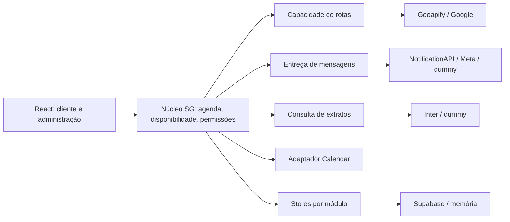

# Núcleo modular e capacidades reutilizáveis

Inventário estático de 22/11/2026, sobre `90d0fa9`. O tamanho de arquivos e a quantidade de APIs indicam acoplamento a investigar; a extração de serviços exige benefício operacional comprovado.

## Estado observado

Frontend React/Vite e backend Spring Boot são unidades de implantação separadas. No backend, `booking/application/GetAvailableSlotsUseCase` e `verification/application/*` já existem; vários outros pacotes de módulos contêm apenas `package-info.java`. `service/ServicoService`, controllers, DTOs e stores continuam compartilhando responsabilidades. No frontend há `entities`, `features`, `widgets` e adaptadores de compatibilidade; `CalendarMateRoutes.tsx` e CSS globais ainda concentram implementação.

## Propriedade e separação

| Capacidade | Implementação e dependências atuais | Dados e responsabilidades | Destino e prioridade |
| --- | --- | --- | --- |
| Agenda/serviços | `ServicoService`, `booking`, `CalendarClient` | Solicitação, estado, vínculo do cliente, atribuição; Google Calendar mantém eventos | Núcleo específico do SG; não separar agora |
| Disponibilidade | `AvailabilityPolicyService`, `AvailabilityBlockService`, `ScheduleRules` | Bloqueios e regras de ocupação; depende da agenda | Núcleo modular; evitar transação distribuída para reservar horário |
| Administração | `AdminAuthService`, stores de usuário/sessão, controllers admin | OWNER/PROVIDER, workspace e acesso aos serviços | Núcleo específico; não transformar permissões locais em identidade genérica |
| Rotas | `RoutesService`, `RouteClient`, Geoapify/Google | Capacidade genérica recebe coordenadas/endereço; núcleo resolve evento e autorização | Primeiro candidato: domínio geográfico, depois porta/modelos próprios; HTTP independente só após benefício demonstrado |
| Endereços/CEP | `AddressAutocompleteService`, `CepService` | Busca/localização genérica; cidades atendidas pertencem ao SG | Candidato posterior a rotas; preservar termos, limites e privacidade dos provedores |
| Entrega de mensagens | `OtpDeliveryClient`, NotificationAPI, Meta, dummy, `MonthlySmsQuota` | Entrega e quota podem ser genéricas; desafio, tentativas, expiração e sessão pertencem ao consumidor | Segundo candidato; isolamento da entrega antes de fila/serviço; controlar duplicação e cobrança |
| Verificação/recuperação | `verification/application`, `VerificationService`, `RecoveryService` | OTP, pendências e efeitos na reserva; stores locais/Supabase | Manter no núcleo nesta fase; não enviar sessão/booking a um mensageiro genérico |
| Consulta financeira | `StatementProvider`, Inter/mTLS/OAuth, `AdminFinanceService` | Conector de extrato potencialmente genérico; retenção, acesso, PIX e apresentação são do SG | Candidato posterior; separar DTOs administrativos e segredos primeiro; nenhuma operação de transferência |
| Histórico/persistência | `BookingHistoryStore`, demais stores, `SupabaseClient` | Histórico e sessões pertencem ao módulo que os usa; Supabase é adaptador | Não criar “microserviço Supabase” ou repositório universal; definir portas locais |
| UI compartilhada | `shared/ui`, `entities`, `widgets` | Componentes visuais e modelos locais | Biblioteca apenas após segundo consumidor real; não é microserviço |

## Classificação de integrações

NotificationAPI/SMS, Meta/WhatsApp, Google Calendar, Geoapify, Google Routes, Supabase e Banco Inter têm código e flags. Sem inspeção das variáveis de produção ou telemetria por integração, seu uso real é **não verificado**. Dummy/desabilitado é uma configuração suportada, não evidência de código morto. Bibliotecas Google têm versões antigas no Gradle; atualização fica em entrega própria com compatibilidade testada. Nenhum módulo deve ser excluído apenas por idade ou falta de chamadas numa janela curta.

## Fronteira pretendida

Rotas, entrega e extratos ainda executam no mesmo processo. As setas são dependências lógicas, não novas chamadas de rede.

## Porta de saída para cada extração

Uma capacidade só ganha deploy/repositório independente após: contrato sem tipos Google/Spring/DTO do SG; consumidor e benefício identificados; ownership dos dados e segredos; autenticação entre serviços; timeout, falha, limites, idempotência e observabilidade; paridade automatizada com sucesso e erro; custo zero confirmado; reversão para o adaptador local; autorização específica de publicação. Estado de reserva e permissão permanecem sob o núcleo.

Para rotas, a entrada futura deve conter origem e destino neutros. `eventId`, token de cliente e sessão admin não cruzam essa fronteira. Para mensagens, consumidor controla o desafio OTP; entrega recebe destino e conteúdo mínimo, com chave de idempotência. Para extratos, consumidor define período e autorização; conector não decide a política administrativa do SG. Esses contratos são propostas de próxima etapa, ainda não APIs publicadas.

## Sequência

1. Caracterizar fluxos menores e isolar política geográfica pura (issue #4).
2. Separar modelos/porta de rotas dos DTOs REST e SDK de calendário, mantendo adaptador local.
3. Caracterizar entrega/quota, isolar conector de mensagens e avaliar segundo consumidor.
4. Revisar conector financeiro e uso real das integrações com acesso adequado.
5. Somente com os critérios acima, propor um serviço independente por PR/ADR e plano operacional.
